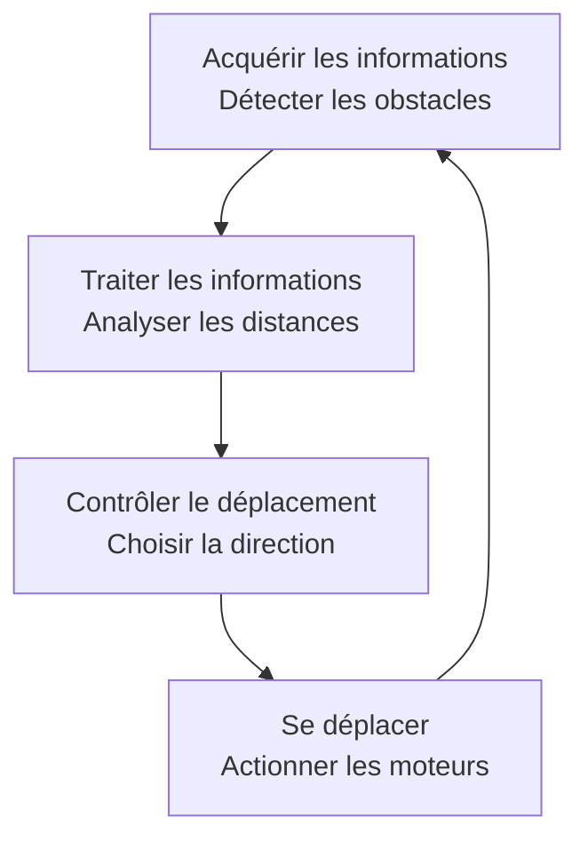

# ProjetPlatefrome
Projet d'études pour le cours de plateformes embarquées

## Livrable 1 / semaine 17-20 novembre

### Description du projet: 
Le projet de fin de session consiste à concevoir une balayeuse (sans la fonction aspiration) miniature capable de se déplacer dans une pièce de façon autonome.

### Fonctionnalité:
L'objectif du projet est d'être capable de déplacer la mini balayeuse sans la toucher. 

Les fonctionnalités principales:
- Déplacement autonome 
- Détection d'obstacle
- Changement de direction
- Navigation intelligente

### Diagramme fonctionnel

### Liste des composants
- Chassis 2pcs
- Wheel 4pcs
- Velocimetry Code Wheel 4pcs
- DC Gear Motor 4pcs
- Battery container 1pcs
- Fastener 8pcs
- 4 Infrared Avoidance Module
- HC-SR04 2022 Ultrasound Sensor
- L298N dual H-bridge motor driver module
- Sensor Shield v5.0
- Tower Pro SG90 Micro Servo
- Arduino Uno R3

### Broches utilisées (peut-être)
Broche A1-A4
Broche A5-A8 (moteur)

### Répartition des tâches
Pour la construction de la machine : L'ensemble de l'équipe
Pour les fonctionnalités: Dépendront des compétences de l'équipe 

  

