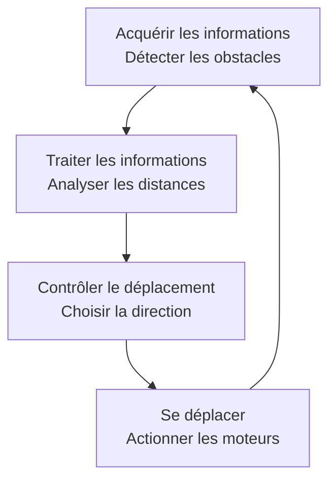
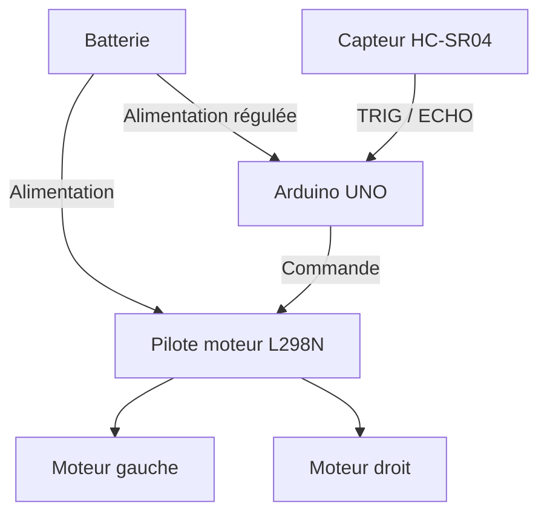

# ProjetPlatefrome
Projet d'études pour le cours de plateformes embarquées

## Livrable 1 / semaine 17-20 novembre

### Description du projet: 
Le projet de fin de session consiste à concevoir une balayeuse (sans la fonction aspiration) miniature capable de se déplacer dans une pièce de façon autonome.

### Fonctionnalité:
L'objectif du projet est d'être capable de déplacer la mini balayeuse sans la toucher. 

Les fonctionnalités principales:
- Déplacement autonome 
- Détection d'obstacle
- Changement de direction
- Navigation intelligente

### Diagramme fonctionnel

## Schéma électronique

### Liste des composants
- Chassis 2pcs
- Wheel 4pcs
- Velocimetry Code Wheel 4pcs
- DC Gear Motor 4pcs
- Conteneur de batteries pour 6 AA batteries 1pcs
- Conteneur de batteries pour 3 AA batteries 1pcs
- Fastener 8pcs
- HC-SR04 2022 Ultrasound Sensor
- Keyestudio TEMT6000 Ambient Light Sensor Module
- L298N dual H-bridge motor driver module
- Arduino nano ESP32 
- Keyestudio LED Module (led lanche) x 2
- Keyestudio RGB LED (led RGB)
- Keyestudio Digital Push Button Switch Module (Boutton pousoir)
- Keyestudio VR sensor (Potentiometre)

### Broches utilisées (Prelimaires)
- Broche A1-A2 (senseur ultrasons)
- Broche A3-A4 (senseur de luminosité)
- Broche A5 (potentiometre)
- Broche D2 (bouton)
- Broche D2-D5 (moteur)
- Broche D6 (led rgb)
- Broche D7-D8 (led blanches)

### Répartition des tâches
- Pour la construction de la machine : L'ensemble de l'équipe
- Pour les fonctionnalités: Dépendront des compétences de l'équipe 

  

