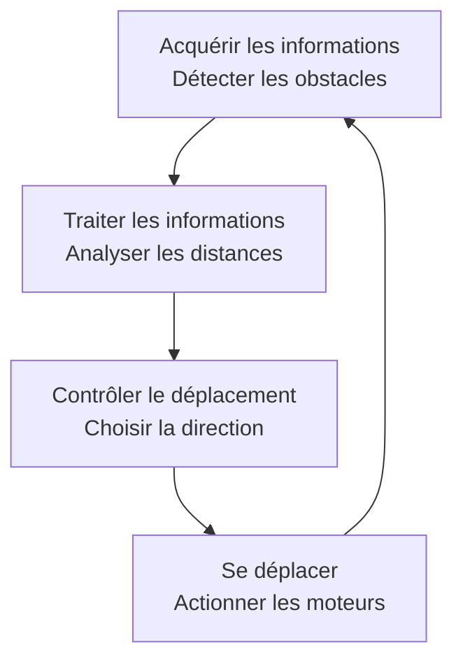

# ProjetPlatefrome
Projet d'études pour le cours de plateformes embarquées

## Livrable 1 / semaine 17-20 novembre

### Description du projet: 
Le projet de fin de session consiste à concevoir une balayeuse (sans la fonction aspiration) miniature capable de se déplacer dans une pièce de façon autonome.

### Fonctionnalité:
L'objectif du projet est d'être capable de déplacer la mini balayeuse sans la toucher. 

Les fonctionnalités principales:
- Déplacement autonome 
- Détection d'obstacle
- Changement de direction
- Navigation intelligente

### Diagrame 

## Diagramme fonctionnel

  

